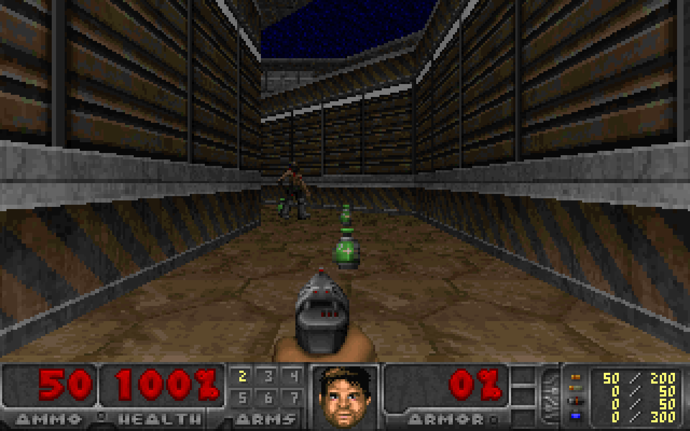

# Freedoom on AWS Lambda Web Functions

The 1993 Doom game engine, compiled to WebAssembly, running inside an AWS Lambda Web Function!



Read how it's built: [Freedoom on AWS Lambda Web Functions](https://www.wooditwork.com/freedoom-on-lambda-web-functions/)

Play it: [fps.julianwood.dev](https://fps.julianwood.dev)

**Controls:** arrow keys or WASD to move, Ctrl to fire, Space or E to use, Shift to run, 1-7 for weapons, Esc for the menu.

Your browser runs no game code. The game runs in the function, and the browser shows the frames it streams back and sends your key presses up.

This is a stateful, long-running app. Web Functions spread requests across execution environments without session affinity, so every environment has to be able to serve every game. Game state lives in Amazon DynamoDB. An environment that gets a game it isn't running rebuilds it by replaying the game's input log, landing on the same tic with identical frames.

The engine is [doomgeneric](https://github.com/ozkl/doomgeneric), a portable version of the original C source, compiled to a 2.7 MB WebAssembly module. Node.js 24 runs it with the built-in `node:wasi`, one instance per game. It plays [Freedoom](https://freedoom.github.io/), the free game data.

## What you need

- An AWS account and Region where Lambda Web Functions are available, with AWS credentials configured for the AWS CLI
- Node.js 24, git and unzip
- [zig](https://ziglang.org/download/) 0.17, to compile the engine
- The AWS CDK bootstrapped in the account and Region (`npx cdk bootstrap` from `infra/`, once)

## Deploy

```bash
npm run setup              # downloads doomgeneric (pinned commit) and Freedoom 0.13.0 (checksum verified)
npm run build              # compiles server/doom.wasm; set ZIG=/path/to/zig if zig isn't on PATH
npm --prefix server install
npm --prefix infra install
npm run deploy             # cdk deploy of the FreedoomOnLambda stack
```

The stack deploys to `CDK_DEFAULT_REGION`, or `us-east-1` if that isn't set. The `Url` output is the game. Open it, click the screen to give it focus, then press Esc for the menu and Enter to start a new game.

The stack creates:

- a DynamoDB table for game state (on-demand, with TTL removing games after six hours)
- an execution role that can write its own logs and read and write that one table
- a log group with one-week retention
- an Amazon S3 bucket for the deployment package, readable by the Lambda service for this account only
- the Web Function, a revision built from `server/`, and an endpoint named `live`

## On the page

Under the game, a status bar shows:

- the frame rate, the stream's bandwidth and a short ID for the execution environment serving you
- the Region, the round trip from your browser to the function, and the CloudFront edge when there is one
- for 10 seconds after a change, a message in place of the stats, such as "Moved to another server. Caught up on 1 min 54 s of play in 60 ms." or, for a spectator, "Watching a copy of the game, about 1 s behind."

The full environment ID and replay details go to the browser console.

To see a handoff, play for a minute, then reload a few times. Each reload is a new stream and can land on another environment. With little traffic the endpoint may run only one environment, so a move isn't guaranteed.

## The endpoint is public

The endpoint uses `ApplicationManaged` auth, so anyone with the URL can play. Two limits cap what that can cost: `maxEnvironments 2` and `rateLimit 100` (requests a second across all users). Each environment runs up to 16 games.

While it runs, you pay for the function's environments, DynamoDB requests, and data transfer out. Each player's stream uses about 500 KB/s while moving and much less while standing still. See [Lambda pricing](https://aws.amazon.com/lambda/pricing/) for current rates.

When you're done:

```bash
npm run destroy
```

This deletes everything the stack created, including the table and the code bucket.

To keep it running for other people, see [Running it behind Amazon CloudFront](#running-it-behind-cloudfront).

## Run locally

Run `npm run setup`, `npm run build` and `npm --prefix server install` first.

```bash
npm test                   # determinism and smoke tests
npm start                  # http://127.0.0.1:3000
```

Without `TABLE_NAME` the server keeps games in memory, which works for one process. With `TABLE_NAME` set to a table with the same keys as the stack's, several local servers can share games. These checks need AWS credentials that can read and write that table:

- `TABLE_NAME=... node test/local-handoff.js` starts two servers on one table and checks a game moves between them on the same tic, with identical frames.
- `TABLE_NAME=... node test/crash-check.js` kills the server running a game and checks the other one takes it over.
- `node test/spectator-check.js` checks a spectator sees the player's frames tic for tic. With `TABLE_NAME`, it tests a copy on a second server. `BASE_URL=<url>` runs it against a deployed endpoint.

If WASI can't open the OS temp folder, as in some sandboxes, set `DOOM_DATA_DIR` to a writable folder.

## How it works

The host drives Doom's clock one tic at a time, so the same inputs always produce the same game. Handoffs, crash takeover and spectators all rely on that.

| Piece | Where | What it does |
|---|---|---|
| Engine | `engine/doomgeneric_wasi.c`, `engine/build.sh` | Headless platform layer for doomgeneric, compiled with `zig cc` to `server/doom.wasm` (WASI, about 2.7 MB). Exports the frame buffer and palette, `dg_push_key()` and `dg_tick()` |
| Game loop | `server/engine.js`, `server/index.js` | One WebAssembly instance per game, loaded with `node:wasi`. One `node:http` loop steps every game 35 times a second |
| Frame stream | `server/index.js`, `server/public/client.js` | One long binary response per viewer. Frames are XORed with the previous frame and sent through one deflate stream, flushed per frame, every second tic (`FRAME_INTERVAL_TICS`). The browser decodes with `DecompressionStream` |
| Input | `POST /api/games/:id/input` | Web Functions don't run WebSockets, so key presses go up as separate POSTs |
| Lease | `sk = lease` | Which environment runs the game (the owner), a generation number, a heartbeat, the last logged tic, and `want` when another environment asks for the game |
| Input log | `sk = log#<tic>` | Key events the owner applied, written every 500 ms |
| Inbox | `sk = in#<ms>#<tab>#<seq>` | Key presses that reached an environment not running the game. The owner reads them every 60 ms |
| Handoff | `server/store.js` | The environment that wants the game sets `want`. The owner writes its last inputs and releases the lease in one transaction. The new owner replays the log, about 30 ms per minute of play, and carries on from the same tic |
| Crash takeover | `server/store.js` | Once the heartbeat is 2.5 s old another environment takes the game. Up to half a second of input is lost |
| Spectators | `/?watch=<token>` | The page shows the watch link and a **Show QR code** button. The token is a one-way hash of the game ID, so it can't be used to play. On the owner's environment a spectator gets the owner's frames. On another environment it gets a copy built from the input log, about 1 to 1.5 s behind. At most 16 spectator streams per environment |

All DynamoDB items sit under `pk = game#<id>` in one table, and every write by the owner is conditional on still holding the lease, so a game never has two writers. Spectators never take a game over and don't keep it alive after the player leaves.

### API

| Method | Path | |
|---|---|---|
| `POST` | `/api/games` | New game ID |
| `GET` | `/api/games/:id/stream` | Frame stream. `x-doom-environment` and `x-doom-start` say which environment serves it and how it got the game |
| `GET` | `/api/watch/:token/stream` | Spectator frame stream |
| `POST` | `/api/games/:id/input` | `{ "cid": "<tab id>", "seq": n, "keys": [[doomKey, pressed], ...] }` |
| `GET` | `/api/ping` | `{ region, environment }`, used by the page's status bar |
| `GET` | `/healthz` | Games, spectators and copies on this environment |

## Performance

Measured on a deployed endpoint in us-east-1 and with two local servers sharing one table:

- Engine start: 16-50 ms. Each game uses about 0.5% of a vCPU.
- Handoff between two servers: the replay took 123 ms, and the new owner's first frame was pixel-identical to the old owner's last.
- Crash takeover: 2.7 s until another server took the game, then a 106 ms replay.
- Spectator copies: every compared frame matched the player's at the same tic.
- Bandwidth while walking and turning: about 500 KB/s at 17.5 fps, 886 KB/s at 35 fps.

`node test/bandwidth-bench.js` compares frame encodings on the same recorded frames. Raw frames with zstd or brotli would save another 30-40%, but browsers can't all decode those natively, so the default stays on deflate.

## Running it behind CloudFront

Custom domains and AWS WAF go through CloudFront. To run the game for other people, put CloudFront in front ([networking docs](https://docs.aws.amazon.com/lambda/latest/dg/web-functions-networking.html)) and lock the endpoint to it:

1. `npx cdk deploy -c auth=iam` from `infra/` switches the endpoint to `IamAuth`. The domain stays the same, and direct requests then get 403.
2. Create a distribution with an origin access control of origin type `lambda` and signing behaviour `always-amz-auth`. Turn caching off, allow all methods, use the `AllViewerExceptHostHeader` origin request policy, and turn compression off, because the stream is already compressed.
3. Allow the distribution to call the endpoint: grant `lambda:InvokeWebFunctionEndpoint` on the endpoint ARN with an `aws:SourceArn` condition, using `aws lambda-web put-resource-policy` ([access control docs](https://docs.aws.amazon.com/lambda/latest/dg/web-functions-endpoint-access-control.html)).

Input POSTs work through CloudFront with no client changes.

## Notes

- `server/package.json` bundles `@aws-sdk/client-dynamodb`, because the nodejs24.x Web Function runtime leaves the SDK out.
- Web Functions currently have L1 CDK constructs, so `infra/bin/app.ts` wires up the role and code upload by hand. It will switch to the L2 construct when that ships.
- Replay time grows with game length. Savegame snapshots would cap it for long games.

## Licences

doomgeneric is GPL-2.0, so this project is GPL-2.0. Freedoom is BSD-3-Clause, and its licence ships with the game data as `server/wad/FREEDOOM-COPYING.txt`. Neither is committed here: `npm run setup` downloads them. `server/public/qrcode.mjs` is [qrcode-generator](https://github.com/kazuhikoarase/qrcode-generator) 2.0.4 by Kazuhiko Arase, MIT, with its licence header kept in the file.

DOOM is a trademark of id Software. This project isn't affiliated with or endorsed by id Software.
